# 🐆 Twist — Servidor web caseiro num tablet de 1 GB de RAM


> Um tablet de entrada, esquecido na gaveta, virou um servidor web 24/7 que hospeda projetos reais — incluindo o **[ounc3.com.br](https://ounc3.com.br)**. Sem root, sem abrir porta no roteador e gastando menos energia que uma lâmpada de LED.

Este repositório documenta **como montei, configurei e mantenho** o servidor, do zero até o site no ar. A ideia é que qualquer pessoa com um Android velho consiga reproduzir.

`[Inserir Print: foto do tablet ligado servindo como servidor, de preferência ao lado do roteador]`

---

## 📑 Sumário

1. [Ficha técnica (hardware)](#-1-ficha-técnica-hardware)
2. [Contexto: por que um tablet?](#-2-contexto-por-que-um-tablet)
3. [Arquitetura](#-3-arquitetura)
4. [Nota técnica: limitações de desempenho](#-4-nota-técnica-limitações-de-desempenho)
5. [Guia passo a passo (do zero ao ar)](#-5-guia-passo-a-passo-do-zero-ao-ar)
   - [5.1 Preparação inicial](#51-preparação-inicial-opções-de-desenvolvedor-e-depuração-usb)
   - [5.2 Depuração e limpeza (debloat)](#52-depuração-e-limpeza-debloat)
   - [5.3 Ambiente Linux: Termux](#53-ambiente-linux-termux)
   - [5.4 Acesso remoto: SSH e SCP](#54-acesso-remoto-ssh-e-scp)
   - [5.5 Servidor web e serviços](#55-servidor-web-e-serviços-que-sobem-sozinhos)
   - [5.6 Conectividade: IP estático](#56-conectividade-ip-estático)
   - [5.7 Exposição segura: Cloudflare Tunnel](#57-exposição-segura-cloudflare-tunnel)
   - [5.8 Estrutura de pastas](#58-estrutura-de-pastas-para-múltiplos-sites)
6. [Monitoramento e manutenção](#-6-monitoramento-e-manutenção)
7. [Solução de problemas](#-7-solução-de-problemas)
8. [Segurança: o que nunca vai para o GitHub](#-8-segurança-o-que-nunca-vai-para-o-github)
9. [Prints e evidências](#-9-prints-e-evidências)
10. [Referências e vídeos de orientação](#-10-referências-e-vídeos-de-orientação)

---

## 🔧 1. Ficha técnica (hardware)

| Item | Especificação |
|---|---|
| **Dispositivo** | Positivo Twist Tab T770 (versão de hardware 1.0) |
| **Processador** | Rockchip RK3326 — 4 núcleos ARM Cortex-A35 |
| **Memória RAM** | 1 GB (~950 MB utilizáveis + ~360 MB de zram comprimida) |
| **Armazenamento interno** | 32 GB (eMMC) |
| **Expansão** | Cartão microSD de 64 GB (arquivos grandes e backups) |
| **Sistema** | Android 8.1 Go Edition, **sem root** |
| **Rede** | Wi-Fi 2.4 GHz, IP estático na rede local |
| **Papel** | Servidor web local compacto e de baixo consumo: testes, páginas de desenvolvimento e projetos pessoais (domínio `ounc3.com.br` e subpastas de teste) |

### Software em produção

| Camada | Ferramenta | Função |
|---|---|---|
| Ambiente Linux | **Termux** + Termux:Boot + Termux:API | Linux completo no Android, início automático e leitura da bateria |
| Web | **nginx** + **php-fpm** | Sites estáticos e PHP |
| Apps | **Node.js** (Express) + **yt-dlp** + **ffmpeg** | Aplicação OunceDown |
| Supervisão | **runit** (`termux-services`) + script *vigia* | Religa qualquer serviço que cair |
| Acesso | **OpenSSH** (só chave) + **ADB** | Administração remota e "porta dos fundos" via USB |
| Exposição | **cloudflared** (Cloudflare Tunnel) | Publica os sites com HTTPS sem abrir portas |

---

## 💡 2. Contexto: por que um tablet?

Tablets de entrada costumam ser aposentados porque ficam lentos para o uso do dia a dia. Mas, para servir páginas web, eles têm tudo o que importa:

- **CPU ARM de 4 núcleos** — de sobra para nginx servindo arquivos estáticos.
- **Bateria embutida** — funciona como um *nobreak* nativo. Se a energia cai, o servidor continua de pé.
- **Consumo baixíssimo** — poucos watts, ligado 24 horas por dia.
- **Wi-Fi integrado e silêncio total** — sem ventoinha, sem cabo de rede.

O tablet foi reaproveitado com um conjunto de ferramentas de desenvolvedor:

- **ADB** — para limpar o Android e instalar o necessário pelo PC.
- **Termux** — um ambiente Linux real rodando como app comum, **sem root**.
- **SSH / SCP** — para administrar e enviar arquivos pelo PC, sem tocar no tablet.
- **Cloudflare Tunnel** — para colocar os sites na internet com HTTPS, sem expor a rede de casa.

Hoje ele hospeda **projetos reais**: páginas locais de desenvolvimento, sites de teste e o **[ounc3.com.br](https://ounc3.com.br)**, onde roda o **OunceDown** (ferramenta de download de mídia em Node.js). É a prova de que hardware de entrada esquecido na gaveta pode virar um ambiente de testes útil de verdade.


<p align="center"></p>

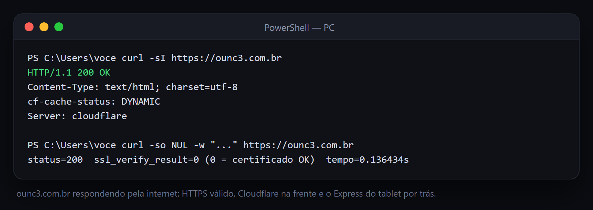

---

## 🗺️ 3. Arquitetura

```
                    Internet
                       │
          https://ounc3.com.br (HTTPS da Cloudflare)
                       │
              ┌────────▼────────┐
              │   Cloudflare    │
              │  (DNS + Edge)   │
              └────────▲────────┘
                       │  conexão de SAÍDA iniciada pelo tablet
                       │  (nenhuma porta aberta no roteador)
┌──────────────────────┼─────────────────────────────────┐
│  Rede de casa        │                                 │
│        ┌─────────────┴─────────────────────────────┐   │
│        │  Tablet Twist (Android 8.1 Go + Termux)   │   │
│        │                                           │   │
│        │  cloudflared ──► localhost:8082  OunceDown│   │
│        │                  localhost:8080  site1    │   │
│        │                  localhost:8081  site2    │   │
│        │  sshd :8022 (somente chave)               │   │
│        │  runit + vigia (religam tudo)             │   │
│        └─────────────▲─────────────────────────────┘   │
│                      │ SSH / SCP pela rede local       │
│                 ┌────┴────┐                            │
│                 │   PC    │  + ADB pelo cabo USB       │
│                 └─────────┘                            │
└────────────────────────────────────────────────────────┘
```

---

## ⚠️ 4. Nota técnica: limitações de desempenho

Servir HTML, CSS e imagens é tranquilo: o nginx usa poucos MB de RAM e responde rápido. O cenário muda em **tarefas pesadas**, como o processamento e o download de vídeos feitos pelo OunceDown.

### O que acontece na prática

| Tarefa | Comportamento no tablet |
|---|---|
| Página estática (nginx) | Instantâneo |
| Consultar informações de um vídeo (yt-dlp) | **~40 segundos** (num PC comum: 2–5 s) |
| Teste medido: clipe de **19 s** pedido em 720p | **207 segundos** do pedido ao MP4 pronto |
| Baixar e montar vídeo em **720p** | Funciona, mas lento — e é o **limite configurado** |
| 1080p / 4K | Desativados no tablet: tempo e memória inviáveis |
| Downloads simultâneos | Limitado a **1 por vez** |

### Por que fica lento

Um download de vídeo não é uma única operação, e sim uma cadeia em que **tudo acontece ao mesmo tempo e disputa o mesmo 1 GB de RAM**:

1. **Ler o link** — o yt-dlp é um programa Python grande. Só carregar o interpretador e os extratores já consome dezenas de MB e vários segundos de CPU num Cortex-A35. Depois ele ainda precisa interpretar as páginas e os scripts da plataforma para descobrir os formatos disponíveis. No YouTube, isso inclui abrir um **Node.js** para resolver um desafio em JavaScript: medido no tablet, esse processo sozinho chegou a **170% de CPU e ~120 MB de RAM**, empurrando a swap de 90 para 183 MB.
2. **Gerar o buffer** — os dados chegam pelo Wi-Fi em pedaços e ficam em memória antes de serem gravados. Com pouca RAM livre, o Android começa a comprimir páginas na **zram**, o que gasta ainda mais CPU justamente quando ela é necessária.
3. **Gravar simultaneamente** — vídeo e áudio de alta qualidade chegam separados. O **ffmpeg** precisa ler os dois arquivos e escrever um terceiro (o MP4 final). O armazenamento interno (eMMC) e, principalmente, o **microSD** têm escrita lenta, e o processador fica preso esperando o disco.
4. **Concorrência com o resto** — nginx, cloudflared, sshd e o próprio Android continuam rodando. O sistema Go mata processos em segundo plano quando a memória aperta, então um pico de consumo pode derrubar serviços (é para isso que existe o *vigia*, ver [5.5](#55-servidor-web-e-serviços-que-sobem-sozinhos)).

O gargalo, portanto, **não é a internet**: é o hardware tentando ler, segurar em memória e gravar ao mesmo tempo com recursos mínimos.

### Mitigações aplicadas

- Resolução máxima limitada a **720p** (`MAX_HEIGHT=720`).
- **Um download por vez** (`MAX_CONCURRENT=1`).
- Arquivos temporários no **armazenamento interno**, não no microSD (FAT32 é mais lento e não aceita permissões).
- Debloat agressivo do Android para liberar RAM ([5.2](#52-depuração-e-limpeza-debloat)).
- Limpeza automática dos arquivos gerados após 30 minutos.

> 📌 O tablet é um **ambiente de testes**. Para produção com tráfego real de vídeos, o plano é migrar o OunceDown para um PC e manter o tablet servindo sites leves.

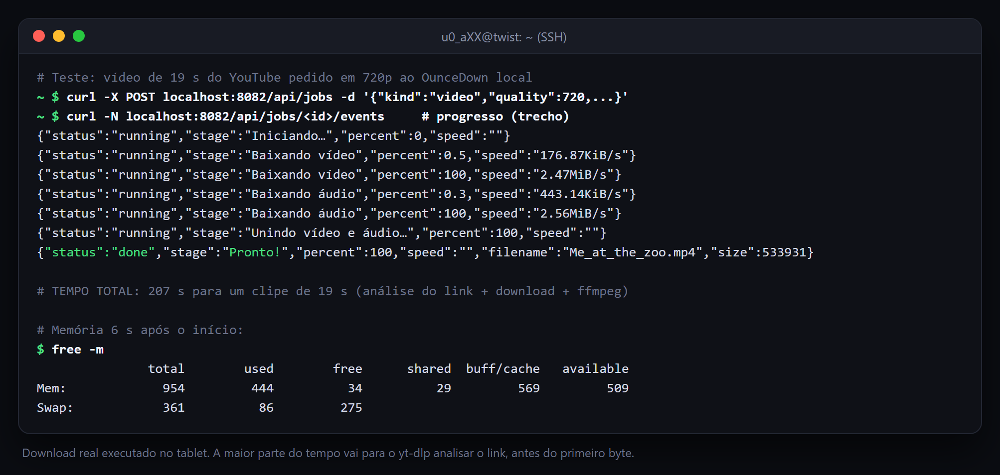

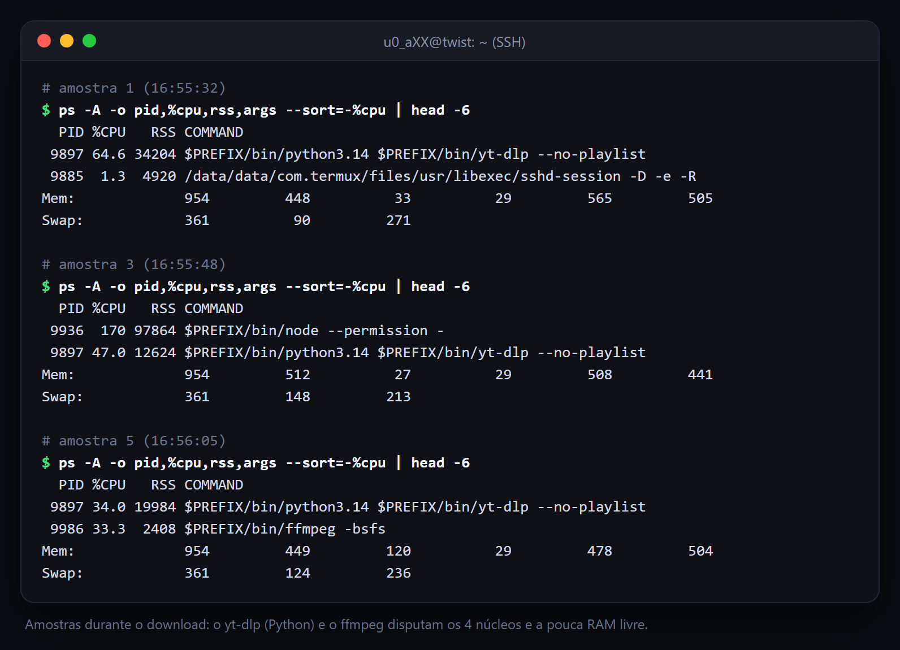

---

## 🛠️ 5. Guia passo a passo (do zero ao ar)

> **Convenções deste guia**
> - `PC>` = comando rodado no PowerShell/terminal do computador.
> - `~ $` = comando rodado dentro do Termux (no tablet ou via SSH).
> - Valores entre `<SINAIS>` são **seus** e devem ser substituídos — nunca publique os valores reais.

### 5.1 Preparação inicial (Opções de desenvolvedor e Depuração USB)

1. No tablet: **Configurações → Sobre o tablet**.
2. Toque **7 vezes** em **Número da versão** até aparecer *"Você agora é um desenvolvedor"*.
3. Volte a **Configurações → Sistema → Opções do desenvolvedor** e ative:
   - **Depuração USB**
   - **Permanecer ativo** (tela não desliga enquanto carrega — opcional, ajuda nos testes)
4. No PC, baixe as **[Android Platform Tools](https://developer.android.com/tools/releases/platform-tools)** (traz o `adb`). O **[scrcpy](https://github.com/Genymobile/scrcpy)** também é útil: espelha a tela do tablet no PC e já inclui o `adb`.
5. Conecte o cabo USB. Se o PC não reconhecer, troque o modo USB do tablet para **PTP (Câmera)** — foi o que funcionou neste aparelho.
6. Autorize o PC na janela que aparece no tablet e confira:

```powershell
PC> adb devices
List of devices attached
<SERIAL_DO_TABLET>    device
```

`[Inserir Print: Opções do desenvolvedor com a Depuração USB ativada]`
`[Inserir Print: terminal do PC mostrando "adb devices" com o tablet listado (serial borrado)]`

### 5.2 Depuração e limpeza (debloat)

Com 1 GB de RAM, cada app nativo rodando em segundo plano faz falta. O objetivo é remover tudo o que não for essencial **sem root**, usando o ADB.

**1. Liste os pacotes instalados:**

```powershell
PC> adb shell pm list packages            # todos
PC> adb shell pm list packages -3         # só os instalados pelo usuário/fabricante
PC> adb shell pm list packages google     # filtra por nome
```

**2. Remova para o usuário atual** (o app sai do sistema em uso, mas pode ser restaurado):

```powershell
PC> adb shell pm uninstall -k --user 0 <nome.do.pacote>
```

**3. Ou apenas desative**, se preferir algo mais conservador:

```powershell
PC> adb shell pm disable-user --user 0 <nome.do.pacote>
```

**Exemplos de candidatos à remoção** (confira o que existe no seu aparelho antes):

| Tipo | Exemplos de pacote |
|---|---|
| Vídeo e música | `com.google.android.youtube`, `com.google.android.apps.youtube.music` |
| Mapas e assistente | `com.google.android.apps.mapslite`, `com.google.android.apps.assistant` |
| Mídia e fotos | `com.google.android.apps.photosgo`, `com.google.android.videos` |
| Apps do fabricante | jogos, lojas e utilitários pré-instalados da Positivo |

> ⚠️ **Não remova:** `com.android.systemui`, `com.android.settings`, o teclado, o launcher em uso, `com.android.providers.*`, `com.android.shell` nem os serviços de Wi-Fi. Remova **um por vez** e teste.
>
> **Desfazer** uma remoção: `adb shell cmd package install-existing <nome.do.pacote>`

**4. Libere o Termux da economia de bateria** (senão o Android encerra o servidor):

```powershell
PC> adb shell dumpsys deviceidle whitelist +com.termux
PC> adb shell dumpsys deviceidle whitelist +com.termux.boot
```

**5. Confira o ganho de memória:**

```powershell
PC> adb shell dumpsys meminfo | more
```

`[Inserir Print: terminal com a lista de pacotes e os comandos de remoção sendo executados]`
`[Inserir Print: comparação de memória livre antes e depois do debloat]`

### 5.3 Ambiente Linux: Termux

> ⚠️ **Não instale o Termux pela Play Store** — a versão de lá está abandonada. Use o **[F-Droid](https://f-droid.org/packages/com.termux/)** ou as **[releases do GitHub](https://github.com/termux/termux-app/releases)**. Os complementos (Termux:Boot e Termux:API) precisam vir **da mesma fonte**.

**1. Instale os três APKs pelo PC:**

```powershell
PC> adb install termux.apk
PC> adb install termux-boot.apk
PC> adb install termux-api.apk
```

Abra o **Termux** e o **Termux:Boot** uma vez no tablet (o Boot só passa a funcionar depois de aberto pela primeira vez).

**2. Atualize e instale os pacotes:**

```bash
~ $ pkg update && pkg upgrade -y
~ $ pkg install -y openssh nginx php-fpm termux-services termux-api \
                   cloudflared nodejs yt-dlp ffmpeg nano curl
~ $ termux-setup-storage      # libera acesso ao armazenamento e ao microSD
```

**3. Reinicie o Termux** (feche e abra o app) para o `termux-services` ativar o supervisor `runit`.

**4. Mantenha o processo acordado:**

```bash
~ $ termux-wake-lock
```

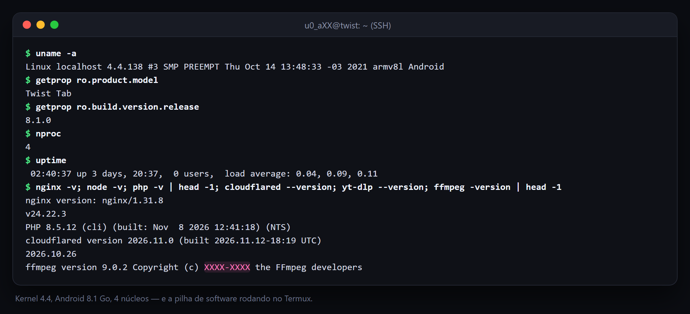

### 5.4 Acesso remoto: SSH e SCP

O SSH roda na porta **8022** (o Termux não pode usar portas abaixo de 1024 sem root) e aceita **somente chave**, nunca senha.

**1. No PC, gere um par de chaves:**

```powershell
PC> ssh-keygen -t ed25519 -f "$HOME\.ssh\twist_ed25519" -C "twist"
```

Isso cria dois arquivos: `twist_ed25519` (**privada — nunca compartilhe**) e `twist_ed25519.pub` (pública).

**2. No tablet, defina uma senha temporária e ligue o SSH:**

```bash
~ $ passwd           # só para o primeiro envio da chave
~ $ whoami           # anote o usuário (algo como u0_aXX)
~ $ sshd
```

**3. Envie a chave pública** (do PC):

```powershell
PC> type "$HOME\.ssh\twist_ed25519.pub" | ssh -p 8022 <USUARIO_TERMUX>@<IP_DO_TABLET> "mkdir -p ~/.ssh && cat >> ~/.ssh/authorized_keys && chmod 600 ~/.ssh/authorized_keys"
```

**4. Desligue o login por senha** no tablet. Edite `$PREFIX/etc/ssh/sshd_config` e garanta:

```
Port 8022
PasswordAuthentication no
KbdInteractiveAuthentication no
PubkeyAuthentication yes
```

```bash
~ $ sshd -t && sv-enable sshd && sv restart sshd
```

> Sempre rode `sshd -t` antes de reiniciar: um erro nesse arquivo pode trancar você fora (aí a saída é o ADB).

**5. Crie um atalho no PC** em `~/.ssh/config`:

```
Host twist
    HostName <IP_DO_TABLET>
    Port 8022
    User <USUARIO_TERMUX>
    IdentityFile ~/.ssh/twist_ed25519
    IdentitiesOnly yes
    ServerAliveInterval 30
```

Agora basta:

```powershell
PC> ssh twist                    # entra no terminal do tablet
PC> ssh twist "uptime"           # roda um comando sem entrar
```

**6. Envie arquivos com SCP** (sempre do PC, fora da sessão SSH; a ordem é `scp ORIGEM DESTINO`):

```powershell
PC> scp -r ".\meu-site\*" twist:www/site1/        # envia uma pasta
PC> scp twist:www/site1/index.html .\             # baixa um arquivo
PC> scp -r twist:www/site1 .\backup-site1         # backup de um site inteiro
```

> 🔙 **Plano B via cabo:** se o Wi-Fi ou o SSH falharem, o ADB sempre funciona:
> ```powershell
> PC> adb shell
> $ run-as com.termux
> ```

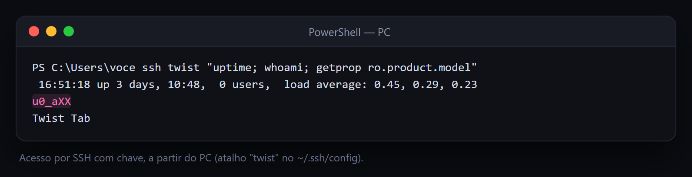

### 5.5 Servidor web e serviços que sobem sozinhos

**1. Ative os serviços no runit:**

```bash
~ $ sv-enable nginx
~ $ sv-enable php-fpm
~ $ sv-enable sshd
~ $ sv status nginx php-fpm sshd     # cada linha deve começar com "run:"
```

**2. Faça o nginx carregar um arquivo por site.** No `$PREFIX/etc/nginx/nginx.conf`, dentro do bloco `http { }`:

```nginx
include sites/*.conf;
```

Exemplo de `$PREFIX/etc/nginx/sites/site1.conf`:

```nginx
server {
    listen 8080;
    server_name _;
    root /data/data/com.termux/files/home/www/site1;
    index index.html index.php;

    location / {
        try_files $uri $uri/ =404;
    }

    location ~ \.php$ {
        include fastcgi_params;
        fastcgi_param SCRIPT_FILENAME $document_root$fastcgi_script_name;
        fastcgi_pass unix:/data/data/com.termux/files/usr/var/run/php-fpm.sock;
    }
}
```

```bash
~ $ nginx -t && sv reload nginx
~ $ curl -I http://127.0.0.1:8080     # deve responder HTTP/1.1 200 OK
```

**3. Apps Node.js como serviço runit** (exemplo do OunceDown). Crie `$PREFIX/var/service/ouncedown/run`:

```sh
#!/data/data/com.termux/files/usr/bin/sh
cd ~/apps/ouncedown
export PORT=8082
export MAX_CONCURRENT=1
export MAX_HEIGHT=720
export YTDLP_PATH="$PREFIX/bin/yt-dlp"
export FFMPEG_PATH="$PREFIX/bin/ffmpeg"
exec node --max-old-space-size=96 server.js 2>&1   # limita o heap do Node a 96 MB
```

```bash
~ $ chmod +x $PREFIX/var/service/ouncedown/run
~ $ sv up ouncedown
```

**4. Início automático no boot.** Crie `~/.termux/boot/01-servidor`:

```sh
#!/data/data/com.termux/files/usr/bin/sh
termux-wake-lock
. $PREFIX/etc/profile.d/start-services.sh
nohup ~/bin/vigia >/dev/null 2>&1 &
```

```bash
~ $ chmod +x ~/.termux/boot/01-servidor
```

**5. O vigia.** O runit religa um serviço que cai, mas e se o próprio runit cair (o Android Go mata processos quando a memória aperta)? O `~/bin/vigia` é um script em loop que, a cada minuto, confere se tudo está rodando e religa o que for preciso. Um serviço `vigia-guarda` confere o vigia — um cuida do outro.

```sh
#!/data/data/com.termux/files/usr/bin/sh
# ~/bin/vigia — versão simplificada
SERVICOS="nginx php-fpm sshd cloudflared ouncedown"
while true; do
  for s in $SERVICOS; do
    sv status "$s" 2>/dev/null | grep -q '^run:' || {
      echo "$(date '+%F %T') religando $s" >> ~/logs/vigia.log
      sv up "$s" 2>/dev/null || . $PREFIX/etc/profile.d/start-services.sh
    }
  done
  sleep 60
done
```

> Toda vez que criar um serviço novo, **adicione o nome na variável `SERVICOS`** e reinicie o vigia.

Resultado testado: depois de desligar e ligar o tablet, **tudo volta ao ar em ~1 min e meio**, sem desbloquear a tela nem abrir o Termux.

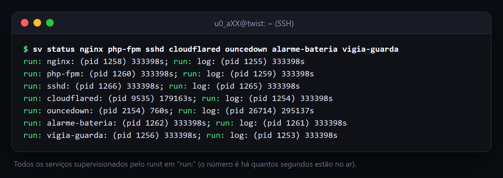

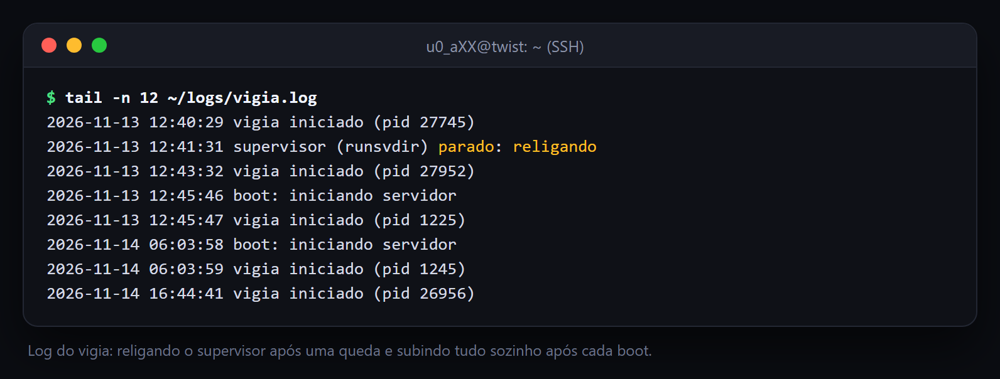

### 5.6 Conectividade: IP estático

Com IP automático (DHCP), o tablet precisa renovar o "empréstimo" do endereço de tempos em tempos. Se a renovação falha, ele fica sem rede — e isso **já derrubou o servidor uma vez**. Com IP fixo, ele não depende disso.

**No tablet:**

1. **Configurações → Rede e Internet → Wi-Fi**.
2. Pressione e segure a sua rede → **Modificar rede → Opções avançadas**.
3. **Configurações de IP: Estático** e preencha:

| Campo | Valor |
|---|---|
| Endereço IP | `<IP_DO_TABLET>` (um IP fora da faixa de DHCP do roteador) |
| Gateway | `<IP_DO_ROTEADOR>` |
| Comprimento do prefixo | `24` |
| DNS 1 / DNS 2 | `1.1.1.1` / `8.8.8.8` |

**No roteador (recomendado):** crie uma **Reserva de DHCP** ligando o **MAC do tablet** ao mesmo IP, para nenhum outro aparelho receber esse endereço.

Conferir pelo PC:

```powershell
PC> adb shell "ip -4 addr show wlan0"
```

> Se trocar de roteador ou de rede, volte para **DHCP** antes, senão o tablet pode não conectar na rede nova.

`[Inserir Print: tela de Wi-Fi do Android com "Estático" configurado (IP borrado)]`

### 5.7 Exposição segura: Cloudflare Tunnel

Para alguém na internet acessar um servidor em casa, o caminho tradicional seria **abrir portas no roteador** — o que expõe a rede e, muitas vezes, nem é possível (operadoras com **CGNAT**).

O túnel faz o caminho inverso: o `cloudflared` no tablet **liga para a Cloudflare** e mantém a conexão aberta. Os visitantes falam com a Cloudflare, que repassa tudo por essa conexão. Resultado:

- ✅ Nenhuma porta aberta no roteador
- ✅ IP de casa nunca exposto
- ✅ HTTPS (cadeado) de graça
- ✅ Funciona até atrás de CGNAT

**Teste rápido (sem domínio):**

```bash
~ $ cloudflared tunnel --url http://127.0.0.1:8080
```

Aparece um endereço aleatório `https://xxxx.trycloudflare.com`. Ótimo para testes, mas muda a cada reinício.

**Túnel fixo com domínio (como o ounc3.com.br):**

**Parte A — painel da Cloudflare**

1. Registre o domínio (no caso, **Registro.br**), adicione-o na Cloudflare e troque os *nameservers* no registrador pelos que a Cloudflare indicar.
2. Em **Zero Trust → Networks → Tunnels → Create a tunnel**, escolha **Cloudflared** e dê um nome (ex.: `twist`).
3. Na tela de instalação, copie **apenas o token** (o texto longo depois de `cloudflared service install`). Não rode os comandos de instalação de lá.
4. Na aba **Public Hostname**, aponte cada domínio para uma porta local:

| Hostname público | Tipo | Serviço |
|---|---|---|
| `ounc3.com.br` | HTTP | `localhost:8082` |
| `www.ounc3.com.br` | HTTP | `localhost:8082` |
| `teste.<seu-dominio>` | HTTP | `localhost:8080` |

**Parte B — no tablet**

```bash
~ $ mkdir -p ~/.cloudflared
~ $ nano ~/.cloudflared/token        # cole o token, Ctrl+O, Enter, Ctrl+X
~ $ chmod 600 ~/.cloudflared/token
```

Serviço runit em `$PREFIX/var/service/cloudflared/run`. O `--token-file` faz o cloudflared ler o token direto do arquivo, então ele **não aparece na lista de processos nem no histórico**:

```sh
#!/data/data/com.termux/files/usr/bin/sh
exec cloudflared tunnel --no-autoupdate \
  --edge region1.v2.argotunnel.com:7844 \
  --edge region2.v2.argotunnel.com:7844 \
  run --token-file "$HOME/.cloudflared/token" 2>&1
```

> Os parâmetros `--edge` apontam direto para os servidores da Cloudflare. No Termux, a descoberta automática (via DNS SRV) às vezes falha; com eles, o túnel conecta sempre.

```bash
~ $ chmod +x $PREFIX/var/service/cloudflared/run
~ $ sv-enable cloudflared
~ $ tail -n 20 $PREFIX/var/log/sv/cloudflared/current   # procure "Registered tunnel connection"
```

Pronto: o site responde no domínio, com HTTPS. Para publicar um site novo depois disso, basta criar o site ([5.8](#58-estrutura-de-pastas-para-múltiplos-sites)) e adicionar um **Public Hostname** no painel — sem mexer no tablet.

> 🔐 **O token é uma senha.** Quem tiver o token consegue publicar qualquer coisa no seu domínio. Nunca cole em prints, issues, commits ou chats.

`[Inserir Print: painel Zero Trust → Tunnels mostrando o túnel "twist" com status HEALTHY]`
`[Inserir Print: aba Public Hostname com os domínios apontando para localhost]`
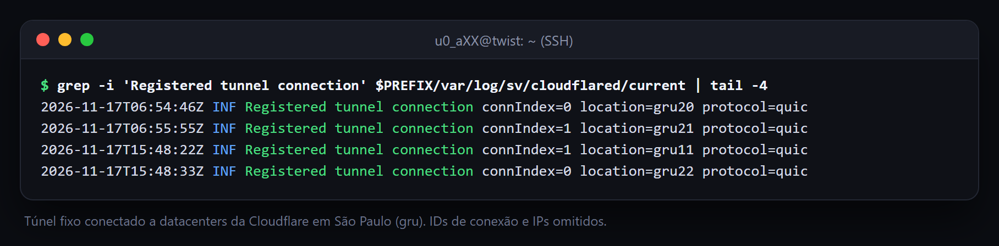

### 5.8 Estrutura de pastas para múltiplos sites

Cada site tem **sua pasta, seu arquivo no nginx e sua porta**. Os sites ficam no armazenamento interno (mais rápido); o microSD guarda arquivos grandes e backups.

```
~ (/data/data/com.termux/files/home)
├── www/                         # sites estáticos/PHP servidos pelo nginx
│   ├── site1/                   # :8080
│   ├── site2/                   # :8081
│   └── testes/                  # páginas de rascunho
├── apps/
│   └── ouncedown/               # app Node.js (:8082) → ounc3.com.br
├── bin/
│   ├── status                   # painel de saúde do servidor
│   ├── vigia                    # religa os serviços
│   ├── alarme-bateria           # avisa bateria baixa / temperatura alta
│   └── tunel-url                # mostra o endereço do túnel rápido
├── logs/
│   └── vigia.log
├── sd -> /storage/<ID_DO_SD>    # atalho para o microSD (64 GB)
│   └── servidor/
│       ├── arquivos/            # arquivos grandes
│       └── backups/             # backups compactados dos sites
├── .cloudflared/
│   └── token                    # 🔐 segredo — chmod 600
├── .ssh/
│   └── authorized_keys          # chaves públicas autorizadas
└── .termux/boot/
    └── 01-servidor              # executado ao ligar o tablet

$PREFIX (/data/data/com.termux/files/usr)
├── etc/nginx/
│   ├── nginx.conf               # include sites/*.conf;
│   └── sites/
│       ├── site1.conf
│       └── site2.conf
└── var/service/                 # serviços do runit
    ├── nginx/  php-fpm/  sshd/
    ├── cloudflared/run
    └── ouncedown/run
```

**Criar um site novo (ex.: site2 na porta 8081):**

```bash
~ $ mkdir -p ~/www/site2 && echo "<h1>site2 no ar</h1>" > ~/www/site2/index.html
~ $ cd $PREFIX/etc/nginx/sites
~ $ sed -e 's/8080/8081/' -e 's#www/site1#www/site2#' site1.conf > site2.conf
~ $ nginx -t && sv reload nginx
~ $ curl http://127.0.0.1:8081
```

Depois é só enviar os arquivos do PC com `scp -r ".\site2\*" twist:www/site2/`.

> 💾 O microSD está em **FAT32**: guarda arquivos normalmente, mas não aceita permissões Unix nem executáveis. Por isso os sites e apps ficam no armazenamento interno.

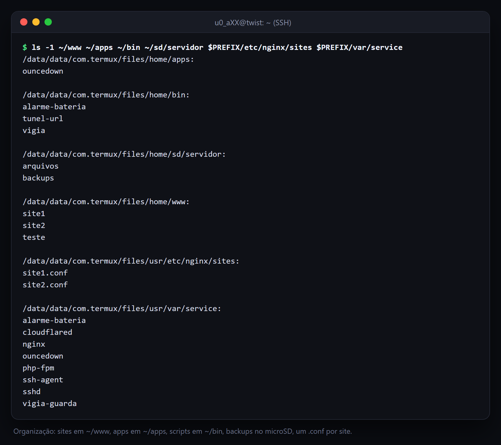

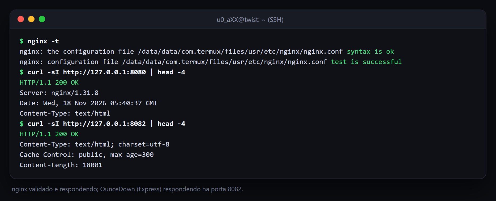

---

## 📊 6. Monitoramento e manutenção

### Painel `status` (tudo de uma vez)

O script [`scripts/status`](scripts/status) mostra em ~3 segundos o sistema, a RAM, o armazenamento, os serviços, os sites (inclusive o teste pela internet), a bateria e os processos mais pesados, com ✔ / ▲ / ✖ e um resumo no fim.

```bash
~ $ cp scripts/status ~/bin/status && chmod +x ~/bin/status   # instalar no tablet
```

```powershell
PC> ssh -t twist status          # painel completo (o -t ativa as cores)
PC> ssh -t twist status -r       # rápido: pula bateria e teste pela internet
PC> ssh -t twist status -w 5     # atualiza a cada 5 s (Ctrl+C para sair)
```

A lista de serviços vem da variável `SERVICOS` do vigia, e as portas dos sites vêm dos `.conf` do nginx: serviço ou site novo aparece no painel automaticamente.

**Limites de alerta:** RAM disponível abaixo de 250 MB (▲) ou 150 MB (✖) · swap acima de 200 MB · disco acima de 80% · carga maior que o número de núcleos · bateria fora da tomada, abaixo de 30% ou acima de 42 °C · qualquer serviço parado ou site sem resposta.

### Comandos individuais

| O que ver | Comando | Referência saudável |
|---|---|---|
| Memória | `free -m` | `available` acima de 150 MB (em repouso: ~520 MB) |
| Processos mais pesados | `ps -A -o pid,rss,args --sort=-rss \| head` | — |
| Disco interno e SD | `df -h ~ ~/sd` | — |
| Serviços | `sv status nginx php-fpm sshd cloudflared ouncedown` | todos em `run:` |
| Bateria | `termux-battery-status` | carregando, abaixo de 42 °C |
| Log do vigia | `tail -n 20 ~/logs/vigia.log` | poucas religações |

**Consumo de referência:** nginx ~7 MB · php-fpm ~20 MB (só com acessos) · cloudflared ~36 MB · sshd ~6 MB.

**Backup de um site no microSD:**

```bash
~ $ tar czf ~/sd/servidor/backups/site1-$(date +%F).tar.gz -C ~/www site1
```

**Rotina sugerida:**

| Quando | O que fazer |
|---|---|
| Toda semana | `sv status`, `free -m`, `df -h` |
| Todo mês | `pkg update && pkg upgrade`; backup dos sites no SD e no PC |
| Após queda de energia | Nada — o Termux:Boot e o vigia sobem tudo. Só confira o log |
| Antes de editar configuração | `cp arquivo arquivo.bak` e testar depois (`nginx -t`, `sshd -t`) |

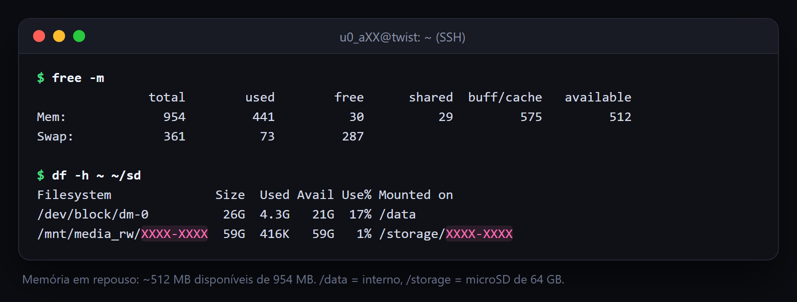

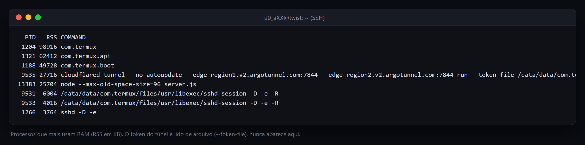

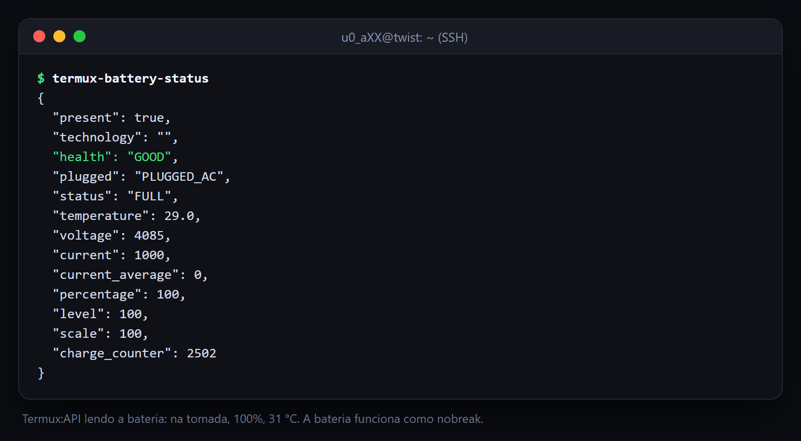

---

## 🧯 7. Solução de problemas

| Problema | O que verificar |
|---|---|
| `ssh twist` não conecta | Tablet ligado e no Wi-Fi? Aguarde 2 min após ligar. Persistindo, use o ADB ([5.4](#54-acesso-remoto-ssh-e-scp)). |
| `Could not resolve hostname twist` | Você rodou o comando **dentro** do tablet. Digite `exit` e rode no PC. |
| Site não abre pelo domínio | `sv status cloudflared` e o log do túnel. O app está ouvindo na porta configurada no painel? |
| Erro 502 em página PHP | `sv restart php-fpm` |
| nginx não sobe após editar | `nginx -t` mostra a linha com erro; corrija ou volte o `.bak`. |
| Serviços morrem sozinhos | Memória baixa: veja `free -m`; confira se o Termux está fora da otimização de bateria. |
| Imagem ou CSS não aparece | No Linux, maiúsculas importam: `Logo.png` ≠ `logo.png`. |
| `adb devices` vazio | Modo USB em **PTP**, outra porta USB, desligar/ligar a Depuração USB. |

---

## 🔐 8. Segurança: o que nunca vai para o GitHub

Este README usa **placeholders** de propósito. Antes de publicar qualquer coisa deste servidor, confira:

| Dado | Por quê | Onde fica |
|---|---|---|
| Token do Cloudflare Tunnel | Dá controle do seu domínio | `~/.cloudflared/token` |
| Chave SSH privada | Dá acesso total ao servidor | `~/.ssh/twist_ed25519` (no PC) |
| IP local, MAC, usuário do Termux, serial do tablet | Facilitam ataques direcionados à sua rede | — |
| Chaves de anúncio, e-mails, `.env` | Credenciais e dados pessoais | arquivos de configuração dos apps |
| Senha do roteador e da rede Wi-Fi | Acesso à rede de casa | — |

Sugestão de `.gitignore` para repositórios de apps que rodam aqui:

```gitignore
.env
.env.*
*.pem
*.key
token
site.config.json
node_modules/
logs/
```

> 📸 **Nos prints:** borre IP, MAC, serial, nome da rede Wi-Fi, usuário do Termux e qualquer token **antes** de subir a imagem.

---

## 📸 9. Prints e evidências

Os prints de terminal foram gerados a partir de **saídas reais** coletadas por SSH no servidor em 17/11/2026, com dados sensíveis mascarados (destacados em rosa: usuário `u0_aXX`, ID do microSD, IDs de conexão e IPs do túnel). Os do site foram capturados direto de `https://ounc3.com.br`. Tudo fica em `docs/prints/`.

- [x] Sessão `ssh twist` a partir do PowerShell
- [x] Sistema e versões dos pacotes no Termux
- [x] `sv status` com todos os serviços em `run:`
- [x] Memória e armazenamento (`free -m`, `df -h`)
- [x] Processos que mais consomem RAM
- [x] Log do vigia religando o supervisor
- [x] Estrutura de pastas no servidor
- [x] nginx validado e sites respondendo
- [x] Log do cloudflared com "Registered tunnel connection"
- [x] Bateria via Termux:API
- [x] Download real no OunceDown (207 s para um clipe de 19 s)
- [x] CPU e memória durante o download
- [x] **ounc3.com.br no ar** (desktop e celular) + HTTPS validado
- [ ] Foto do tablet funcionando como servidor
- [ ] Opções do desenvolvedor com a Depuração USB ativada *(precisa do tablet em mãos)*
- [ ] `adb devices` listando o tablet *(precisa do cabo USB)*
- [ ] Debloat: lista de pacotes e memória antes × depois *(precisa do cabo USB)*
- [ ] Wi-Fi com IP estático *(tela do Android, borrar o IP)*
- [ ] Painel Cloudflare: túnel **HEALTHY** e Public Hostnames *(precisa do login na Cloudflare)*

Para inserir uma imagem no Markdown:

```markdown

```

---

## 📚 10. Referências e vídeos de orientação

Material que serviu de base e ajuda a entender cada etapa com mais calma. A documentação oficial vem primeiro, porque é a fonte mais confiável e a mais atualizada; os vídeos complementam com a parte visual.

> 🇧🇷 = em português · 🇺🇸 = em inglês (dá para ativar a legenda traduzida no YouTube: ⚙️ → Legendas → Traduzir automaticamente → Português).

### Documentação oficial

| Tema | Fonte |
|---|---|
| ADB (Android Debug Bridge) | [Android Developers — Android Debug Bridge](https://developer.android.com/tools/adb) |
| Termux (download correto) | [Termux no F-Droid](https://f-droid.org/packages/com.termux/) |
| SSH no Termux | [Termux Wiki — Remote Access](https://wiki.termux.com/wiki/Remote_Access) |
| Cloudflare Tunnel | [Cloudflare Docs — Cloudflare Tunnel](https://developers.cloudflare.com/cloudflare-one/networks/connectors/cloudflare-tunnel/) |
| Debloat com interface gráfica | [Universal Android Debloater Next Generation (GitHub)](https://github.com/Universal-Debloater-Alliance/universal-android-debloater-next-generation) |

### Vídeos por etapa

**Visão geral: Android antigo como servidor**

- 🇧🇷 [Transformando um dispositivo Android em um Servidor com o Termux!](https://www.youtube.com/watch?v=afBAz4kMZQM) — VegaData
- 🇧🇷 [Instalando Termux e SSH para transformar um Android antigo em um servidor VPS — Parte 01](https://www.youtube.com/watch?v=yGIgQGxr448) — KF Host Tutoriais
- 🇺🇸 [Turning an Old Android Phone into a Server!](https://www.youtube.com/watch?v=VCItcLP_bFg) — shr3sth
- 🇺🇸 [Turning a Budget Android Phone into a Dedicated Web Server](https://www.youtube.com/watch?v=YK-drhR5_4U) — SjslTech

**Debloat por ADB (seção [5.2](#52-depuração-e-limpeza-debloat))**

- 🇺🇸 [Uninstall bloatware from Android with ADB](https://www.youtube.com/watch?v=dawEil2EdjQ) — Victor Lin
- 🇺🇸 [Universal Android Debloater on Windows, Mac or Linux (no root)](https://www.youtube.com/watch?v=faeCUtsEpAs) — M Ayan Sajid

**Termux e nginx (seções [5.3](#53-ambiente-linux-termux) e [5.5](#55-servidor-web-e-serviços-que-sobem-sozinhos))**

- 🇺🇸 [Run Your Website on Android with Termux & NGINX (Step-by-Step)](https://www.youtube.com/watch?v=x0UWNXpILiY) — CST

**SSH e autenticação por chave (seção [5.4](#54-acesso-remoto-ssh-e-scp))**

- 🇧🇷 [Conectando ao celular Android pelo SSH (Termux) — Parte 02](https://www.youtube.com/watch?v=XuPQK9SYpZc) — KF Host Tutoriais
- 🇺🇸 [How To Install And Use ssh In Termux (No Root)](https://www.youtube.com/watch?v=C4eNyMNPPG4) — Birds In Tech
- 🇺🇸 [Secure Shell using keys instead of passwords with OpenSSH](https://www.youtube.com/watch?v=TYrLuKXibAY) — NetSecProf
- 🇺🇸 [Using OpenSSH Key-Based Password-less Authentication](https://www.youtube.com/watch?v=LGUyqbyDNDg) — NetSecProf
- 🇺🇸 [How to generate SSH key pair using ssh-keygen](https://www.youtube.com/watch?v=8pvLtrG7DKg) — Simplified Guide

**Cloudflare Tunnel (seção [5.7](#57-exposição-segura-cloudflare-tunnel))**

- 🇧🇷 [Cloudflare Tunnel: acesse seu site externamente sem abrir portas no roteador](https://www.youtube.com/watch?v=Y0LTZZCyPko) — Sauber Lab
- 🇺🇸 [EXPOSE your home network to the INTERNET!! (it's safe)](https://www.youtube.com/watch?v=ey4u7OUAF3c) — NetworkChuck
- 🇺🇸 [Cloudflare Tunnel Setup Guide — Self-Hosting for EVERYONE](https://www.youtube.com/watch?v=hrwoKO7LMzk) — Raid Owl
- 🇺🇸 [Getting Started With Cloudflare Tunnels](https://www.youtube.com/watch?v=_OYWOPlWFFY) — What's New Andrew

> ⚠️ **Antes de seguir um vídeo:** a maioria dos tutoriais de Cloudflare Tunnel usa um PC com Linux ou Docker, não o Termux, então os comandos de instalação mudam. Use os vídeos para entender o conceito e o painel da Cloudflare, e os comandos deste README para o tablet. Vídeos envelhecem: em caso de dúvida, a documentação oficial vale mais. Links conferidos em 17/11/2026.

---

## 🐆 Sobre

Projeto da **Ounc3** — desenvolvimento indie, hardware reaproveitado e muita linha de comando.

- 🌐 Site: **[ounc3.com.br](https://ounc3.com.br)**
- 💻 GitHub: **[MajorCaio](https://github.com/MajorCaio)**

> *"Se roda nginx, serve."*
